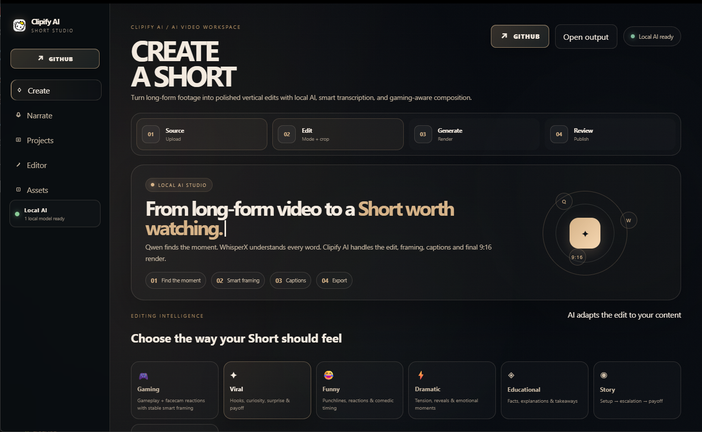
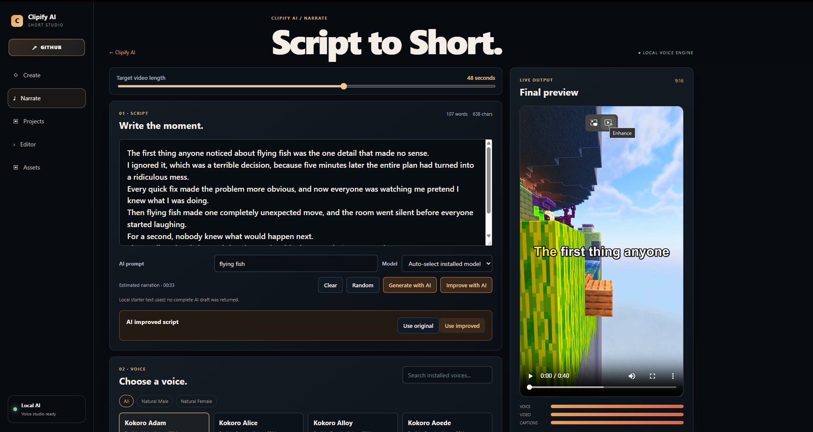
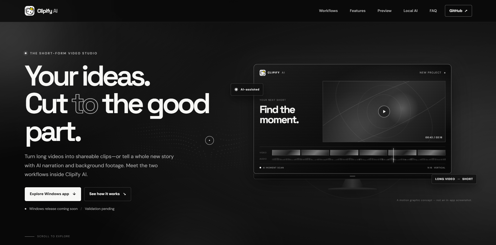

<div align="center">

# Clipify AI

### Turn long videos into vertical clips. Build narration videos from a script.

**A Windows desktop studio for clipping, captions, and narrated video.**

<p>
  <a href="https://ai.projectclipzy.workers.dev/">Project website</a>
  &nbsp; | &nbsp;
  <a href="https://github.com/sherlock-dev-ai/Clipify-AI/releases">Windows installer releases</a>
  &nbsp; · &nbsp;
  <a href="docs/AI_SELECTION_POLICY.md">AI selection policy</a>
</p>


</div>

## Made for two video workflows

| **Clip a moment** | **Create a narration** |
|:--|:--|
| Find candidate moments in longer footage, then make vertical clips with timed captions. Choose a style such as Gaming, Viral, Funny, Dramatic, Educational, or Story. | Draft or generate a script, choose a voice and background footage, and render a narration video. |
|  |  |

The clipping and narration workflows are separate parts of the desktop application. The website preview below is the project site, not an in-app screen.

<p align="center">
  <a href="https://ai.projectclipzy.workers.dev/">
    
  </a>
</p>

## Download the Windows preview

**[Open Clipify AI Releases](https://github.com/sherlock-dev-ai/Clipify-AI/releases)** to see installers published for this project.

The verified preview installer candidate is **Clipify AI 2.0.0 for Windows x64**. Its release asset is not attached yet:

| File | Size | SHA-256 |
|:--|--:|:--|
| `Clipify AI Setup-20261018-205733-726.exe` | 405.7 MiB | `D5E340E8AA8E8342C984D4D41593EB28617BAC209B79A8D723F091C6C341DB96` |

After downloading, verify the file hash in PowerShell:

```powershell
Get-FileHash ".\Clipify AI Setup-20261018-205733-726.exe" -Algorithm SHA256
```

This is a preview build. The installer is not digitally signed, so Windows may show an unknown-publisher warning. Review the installer prompts before continuing.

## Local AI

Clipify AI can use Qwen through a locally configured Ollama service to review clip candidates. Ollama and a compatible model must be available on the user's computer; model availability and performance depend on the system. See the [AI selection policy](docs/AI_SELECTION_POLICY.md) for how approvals, rejections, recoverable candidates, and unavailable responses are handled.

## Setup notes

- The installer targets 64-bit Windows. A minimum Windows version and hardware profile have not been certified for general release.
- Runtime components and selected AI models may need to be downloaded during setup. Model downloads can be several gigabytes; the actual selection and estimate are shown by the installer.
- Qwen review requires a compatible local Ollama service and an available model; setup and runtime depend on the selected configuration and local environment.
- This preview has not been certified for general-release compatibility.

## Project links

- **Website:** [ai.projectclipzy.workers.dev](https://ai.projectclipzy.workers.dev/)
- **Downloads:** [GitHub Releases](https://github.com/sherlock-dev-ai/Clipify-AI/releases)
- **Release notes:** [Preview notes](docs/RELEASE_NOTES_PREVIEW_2026-10-18.md)
- **AI behavior:** [AI selection policy](docs/AI_SELECTION_POLICY.md)

<div align="center">

---

*Clipify AI | Windows video clipping and narration preview*

</div>
