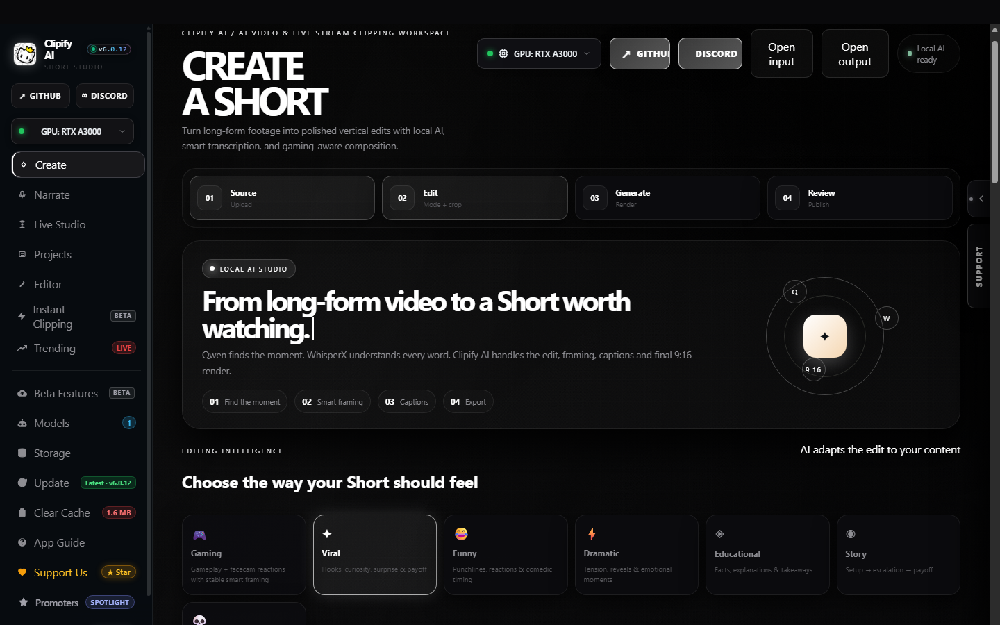
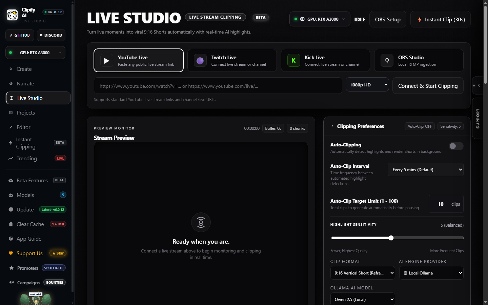
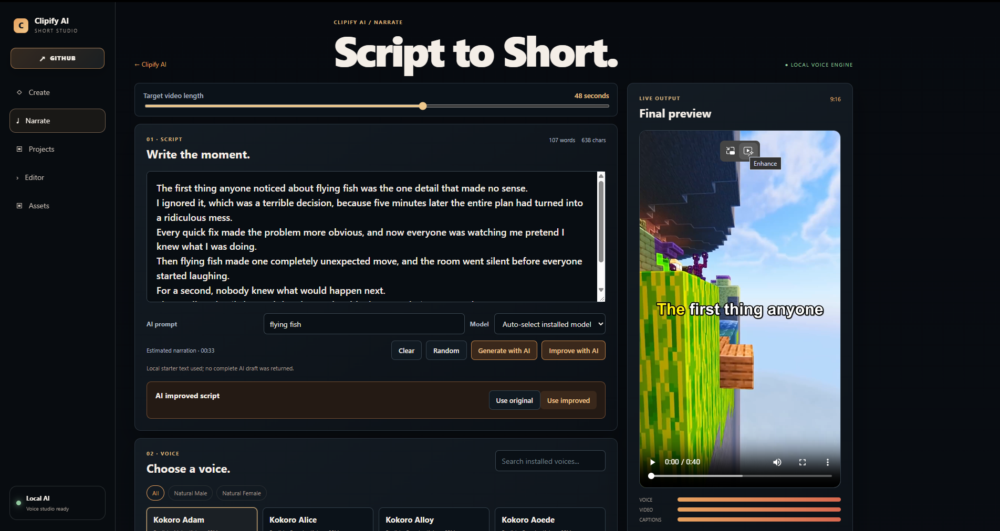
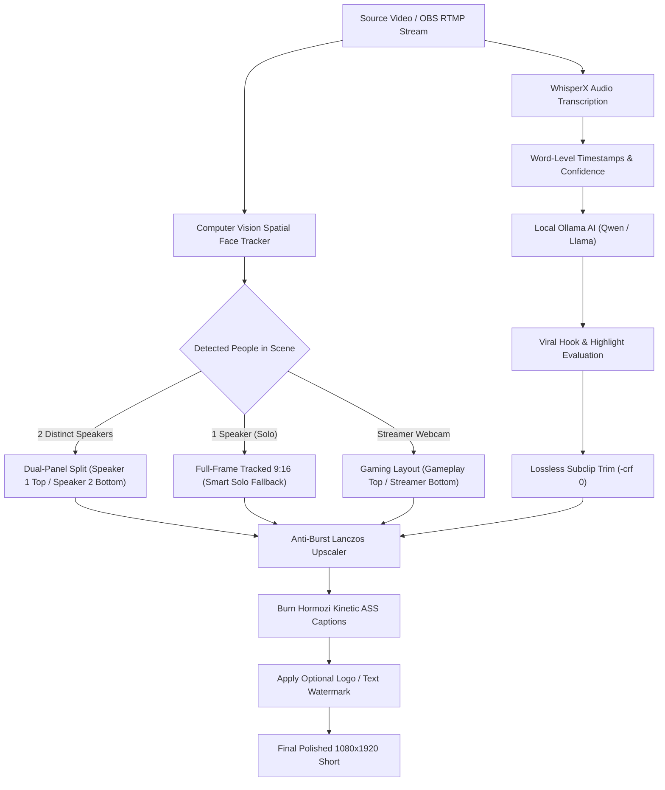

<div align="center">

# 🎬 Clipify AI: Free & Open-Source AI Video Clipper, LIVE Stream Clipping & Shorts Studio

### The 100% Free, Private, Local Alternative to OpusClip, Munch & Submagic.
#### Turn long videos & livestreams into viral vertical 9:16 Shorts with local AI highlight ranking, animated captions, Clippy AI assistant & faceless narration.

**100% Free · 100% Private & Local · Zero Subscriptions · Zero Watermarks · Unlimited Video Length**

<p align="center">
  <a href="https://github.com/sherlock-dev-ai/Clipify-AI-Video-Clipper-FREE/releases/tag/v4.0.11"><strong>🚀 Download v4.0.11 Release (Windows x64) »</strong></a>
  <br><br>
  <a href="#-whys-clipify-the-best">🏆 Why's Clipify the Best?</a> ·
  <a href="#-clipify-ai-vs-paid-clippers-battle">🥊 Competitor Battle</a> ·
  <a href="#-desktop-studio-tour">📸 Studio Tour</a> ·
  <a href="#-live-studio-obs--streams">🔴 Live Studio</a> ·
  <a href="#-anti-burst-lanczos-upscaler">✨ Anti-Burst Upscaler</a> ·
  <a href="#-quick-start">⚡ Quick Start</a>
</p>

[](https://github.com/sherlock-dev-ai/Clipify-AI-Video-Clipper-FREE/releases/tag/v4.0.11)
[](https://github.com/sherlock-dev-ai/Clipify-AI-Video-Clipper-FREE/releases/tag/v4.0.11)
[](LICENSE)
[](https://python.org)
[](https://ollama.ai)
[](https://github.com/m-bain/whisperX)

</div>

<p align="center">
  
</p>

---

> [!TIP]
> 💬 **Community & Clips Showcase**: Join our creator group chat on Instagram to share viral clips, exchange prompt workflows, and request features: [**Join Instagram Community Chat**](https://ig.me/j/AQj1lYCWh_iV_S7J/)

---

## 📥 Download Clipify AI (v4.0.11 Latest)

> [!IMPORTANT]
> **🛡️ Note on Windows SmartScreen**:
> Clipify AI is **100% free, local, clean, and open-source software**.
> Commercial vendors pay thousands of dollars annually for EV Code Signing Certificates. Because Clipify AI is a free community open-source project without expensive corporate certificates, Microsoft Windows Defender SmartScreen may display **"Windows protected your PC (unrecognized app)"**.
>
> **How to run in 2 clicks:**
> 1. Click **"More info"** on the Windows SmartScreen blue prompt.
> 2. Click the **"Run anyway"** button.

| Package | Platform | Version | Size | Download Link | SHA-256 Checksum |
| :--- | :---: | :---: | :---: | :--- | :--- |
| **`Clipify.AI.Setup.4.0.11.exe`** | Windows 10/11 (64-bit) | `v4.0.11` | **331.8 MB** | [**📥 Download Standalone Windows Installer**](https://github.com/sherlock-dev-ai/Clipify-AI-Video-Clipper-FREE/releases/download/v4.0.11/Clipify.AI.Setup.4.0.11.exe) | `09F767F39486B4517974226597A67A5A5A9763A309AABDF85A7ABCD11F95EB11` |
| **`update-v4.0.11.zip`** | In-Place Hot Patch | `v4.0.11` | **3.3 MB** | [**⚡ Download Fast Update ZIP**](https://github.com/sherlock-dev-ai/Clipify-AI-Video-Clipper-FREE/releases/download/v4.0.11/update-v4.0.11.zip) | Fast in-place updater asset |
| **`Clipify AI (beta).apk`** | Android 8.0+ | `v3.9.0` | **13.8 MB** | [**📱 Download Android APK**](https://github.com/sherlock-dev-ai/Clipify-AI-Video-Clipper-FREE/releases/download/v3.9.0/Clipify.AI.beta.apk) | Community mobile companion |

#### Verify Installer SHA-256 Integrity:
```powershell
Get-FileHash ".\Clipify.AI.Setup.4.0.11.exe" -Algorithm SHA256
```

---

# 🏆 Whys Clipify the best?

Clipify AI was built with a single goal: **liberate content creators from predatory SaaS subscriptions, cloud upload queues, and artificial duration caps.** 

Here is why Clipify AI is the most powerful, complete, and creator-friendly video clipping studio ever built:

```
┌────────────────────────────────────────────────────────────────────────────────────────┐
│                                 THE CLIPPED ECOSYSTEM                                  │
├─────────────────────────┬──────────────────────────────┬───────────────────────────────┤
│ 1. HIGHLIGHT DETECTOR   │ 2. REFRAMING & SPLIT ENGINE  │ 3. POST-PRODUCTION SUITE      │
│  • WhisperX Word Sync   │  • Smart Face & Body Tracking│  • Kinetic Word-by-Word ASS   │
│  • Ollama Viral Scoring │  • 2-Speaker Podcast Split   │  • In-App 9:16 Canvas Editor  │
│  • Emotion & Hook Model │  • Solo Fallback (No Half-Cut│  • Logo Brand Transparency    │
│  • Climax Sound Detection│  • Gaming Facecam Cluster    │  • Kokoro Faceless Narrator   │
│  • OBS / RTMP Stream In │  • Draggable Split (30%-70%) │  • Anti-Burst Lanczos Upscaler│
└─────────────────────────┴──────────────────────────────┴───────────────────────────────┘
```

---

### 1. 💸 100% Free Forever — Zero Subscription Rent
- **Stop paying $19 – $119 every single month.** Over a year, cloud clippers like OpusClip, Munch, and Submagic charge you **$240 to $1,400+**.
- Clipify AI is **completely free and open-source**. Every single feature—transcription, viral ranking, split-screen reframing, faceless narration, and export—is included at zero cost.

### 2. 🔒 100% Local & Private — Zero Server Uploads
- **Your footage never leaves your machine.** No waiting in cloud server queues. No worrying about unpublished podcast leaks, private gameplay footage, or copyright strikes from cloud caching.
- Runs on your local GPU/CPU with **zero video length limits** and **no monthly credit caps**. Clip 5-hour livestreams or 20-minute interviews with equal ease.

### 3. 🔴 Live Studio: Real-Time Livestream AI Clipper (OBS Studio, Twitch, Kick, YouTube)
- **No paid cloud clipper supports local real-time livestream monitoring.** 
- Connect OBS directly via RTMP (`rtmp://127.0.0.1:1935/live`) or stream URLs.
- Background rolling buffer monitors gameplay climax moments and chat reactions while you play. Hit **Instant Snapshot (15s / 30s / 60s)** or enable **Auto-Clip** to generate polished vertical Shorts automatically before your stream even finishes!

### 4. 🤖 Built-in Clippy AI Assistant (Instant Co-Pilot)
- Need help clipping live streams or burning text overlays? Click the sleek, flush edge toggle arrow (`‹`) pinned on the right edge.
- **Deep-Link Auto Navigation**: Ask Clippy *"How do I clip live streams?"* and it will automatically navigate to Live Studio (`/live`) and guide you step-by-step.
- **Smart Model Routing**: Benchmarks your local Ollama models (`qwen2.5:3b`, `qwen3:4b`, `llama3.2`, `mistral`) and dynamically pairs with your fastest local engine.

### 5. 🎙️ Smart Solo & Dual Split Screen (No Half-Body Glitches)
- **True 2-Person Podcast Layout**: Automatically identifies Speaker 1 (top) and Speaker 2 (bottom) with centered headroom and natural torso margins.
- **Smart Solo Speaker Fallback**: Unlike naive competitors that blindly chop single speakers into weird face-top / wrist-bottom cuts, Clipify AI verifies spatial cluster separation (`sep >= 0.18`). If only one person is on screen, it automatically falls back to full-height 9:16 solo vertical framing!
- **Interactive Draggable Divider**: Customize the split ratio freely in Beta Lab from **Top 30% / Bottom 70%** to **Top 70% / Bottom 30%**.

### 6. ✨ Anti-Burst Lanczos Upscaler (Pristine 1080p Quality)
- **No blurry, macroblocked re-encodes.**
- **Lossless Subclip Trimming**: Cuts raw subclips using lossless x264 (`-crf 0`), completely eliminating generational degradation before framing begins.
- **4 Precision Profiles**:
  - `Ultra`: Lanczos scaling + unsharp mask + CRF 17 + 10 Mbps (Maximum crispness, anti-burst).
  - `High`: Lanczos scaling + subtle sharpening + CRF 18 + 8 Mbps (Recommended balance).
  - `Balanced`: Standard 1080p high-speed encoding + CRF 22 + 5 Mbps.
  - `Fast`: Fast bilinear preview + CRF 25.

### 7. 💬 Hormozi Kinetic Animated Captions
- Word-by-word highlighted karaoke subtitles with pop animations, customizable accent colors (Gold Yellow, Lime Green, Cyan Sky, Coral Red, Pink Lavender).
- Creator fonts pre-loaded: **Montserrat**, **The Bold Font**, **Komika Axis**, and **Anton**.
- 100% frame-accurate audio sync via WhisperX word-level alignment.

### 8. 🗣️ Faceless Narration Studio (Kokoro Neural Speech)
- Turn text prompts or Reddit stories into viral Shorts with one click.
- Synthesize natural Kokoro ONNX neural voices (Heart, Bella, Adam, Michael, Sarah, Nicole) with sub-2ms preview caching over dynamic gameplay backgrounds (Minecraft parkour, GTA racing, subway runner).

### 9. ✂️ In-App 9:16 Video Editor & Branding Suite
- Real-time video player with scrubber timeline.
- **Logo Overlays**: Draggable watermark, transparency slider (0% to 100%), scale adjustment (5% to 50%), and auto chroma-key background removal.
- **Timed Text Cards**: Drag custom text onto the 9:16 canvas and set exact in/out timestamps.

### 10. ⚡ 5-Second In-Place Live Updater
- Never redownload full installers for feature updates. Press **Update** inside the app to download and patch your setup via `update-vX.X.X.zip` in under 5 seconds!

---

# 🥊 Clipify AI vs Paid Clippers Battle

Why pay recurring monthly subscriptions for cloud waitlists and video caps? Here is how Clipify AI crushes the commercial competition:

| Feature | OpusClip | Munch | Submagic | Klap | Vizard.ai | 🏆 Clipify AI (v4.0.11) |
| :--- | :---: | :---: | :---: | :---: | :---: | :---: |
| **Monthly Pricing** | $19 – $49/mo | $49 – $119/mo | $20 – $50/mo | $29 – $79/mo | $16 – $32/mo | **100% Free ($0/mo)** |
| **Annual Cost** | $228 – $588/yr | $588 – $1,428/yr | $240 – $600/yr | $348 – $948/yr | $192 – $384/yr | **$0 (Zero Forever)** |
| **Processing Location** | Cloud Server | Cloud Server | Cloud Server | Cloud Server | Cloud Server | **100% Local PC** |
| **Video Privacy** | Uploaded to cloud | Uploaded to cloud | Uploaded to cloud | Uploaded to cloud | Uploaded to cloud | **100% Private (No Uploads)** |
| **Duration Limit** | 60–150 min/mo | Credit-limited | 20–40 videos/mo | 10–30 videos/mo | 120–300 min/mo | **Unlimited Video Length** |
| **Watermarks** | Yes (Free tier) | Yes (Free tier) | Yes (Free tier) | Yes (Free tier) | Yes (Free tier) | **Zero Watermarks Ever** |
| **Live Stream Clipper** | ❌ None | ❌ None | ❌ None | ❌ None | ❌ None | **✅ Live Studio (OBS RTMP)** |
| **Built-in AI Assistant** | ❌ None | ❌ None | ❌ None | ❌ None | ❌ None | **✅ Clippy AI Co-Pilot** |
| **Solo Smart Fallback** | ❌ Chops in half | ❌ Chops in half | ❌ Chops in half | ❌ Fails | ❌ Chops in half | **✅ Auto 9:16 Full Solo** |
| **Draggable Split Resizer** | ❌ Fixed 50/50 | ❌ Fixed 50/50 | ❌ Fixed 50/50 | ❌ Fixed 50/50 | ❌ Fixed 50/50 | **✅ Draggable 30%–70%** |
| **Anti-Burst Upscaler** | ❌ Cloud bitrate | ❌ Compressed | ❌ Compressed | ❌ Compressed | ❌ Compressed | **✅ Lanczos + Unsharp** |
| **Faceless Narrator TTS** | ❌ None | ❌ None | ❌ None | ❌ None | ❌ None | **✅ Kokoro Neural TTS** |
| **In-Place Live Updater** | ❌ None | ❌ None | ❌ None | ❌ None | ❌ None | **✅ 1-Click Fast Update** |
| **Works 100% Offline** | ❌ Requires Web | ❌ Requires Web | ❌ Requires Web | ❌ Requires Web | ❌ Requires Web | **✅ Fully Offline Ready** |

---

## 📸 Desktop Studio Tour

### 🎬 Create Studio: High-CTR AI Video Clipper
<p align="center">
  
</p>

*The main control cockpit: import YouTube URLs or local MP4 files, choose editing modes (Gaming, Viral, Funny, Dramatic, Educational, Story), pick Ollama models, and batch-render vertical shorts.*

---

### 🧪 Beta Testing Lab & Interactive Split Resizer
<p align="center">
  
</p>

*Fine-tune your compositions: interactively drag the split screen slider between 30% and 70%, customize live video padding, and add timed text overlays on the 9:16 canvas.*

---

### 🔴 Live Studio: Real-Time Stream Clipper (OBS Studio & RTMP)
<p align="center">
  
</p>

*Stream live while Clipify AI monitors your audio and gameplay. Ingest directly from OBS RTMP (`rtmp://127.0.0.1:1935/live`), auto-detect stream climax highlights, and export Shorts in real-time.*

---

### 🎙️ Narrate Studio: Faceless Story Shorts Studio
<p align="center">
  
</p>

*Generate viral scripts with local Qwen AI, pick from hyper-realistic Kokoro neural voices, preview audio with sub-2ms caching, and burn subtitles directly over background gameplay.*

---

### 🤖 Model Hub & Engine Manager
<p align="center">
  
</p>

*Discover, benchmark, and switch between local Ollama models (`qwen2.5:3b`, `qwen3:4b`, `deepseek-r1`, `llama3.2`) with live latency and VRAM analytics.*

---

### 🎛️ 9:16 Video Editor & Project Archive
<p align="center">
  
</p>

*Organize, preview, and customize rendered Shorts with draggable watermarks, opacity sliders, chroma key background removal, and direct social export.*

---

## ⚡ How Clipify AI Works (Local Architecture)



---

## 🚀 Quick Start Guide

### Method 1: Windows 1-Click Installer (Recommended)

1. Download **[`Clipify.AI.Setup.4.0.11.exe`](https://github.com/sherlock-dev-ai/Clipify-AI-Video-Clipper-FREE/releases/download/v4.0.11/Clipify.AI.Setup.4.0.11.exe)** (331.8 MB).
2. Run the installer. It will automatically:
   - Configure embedded Python 3.11 runtime.
   - Install required FFmpeg binaries, WhisperX, and PyTorch.
   - Detect or pull local Ollama models (`qwen2.5:3b`).
   - Create desktop and Start Menu shortcuts.
3. Launch **Clipify AI** from your desktop and start creating viral shorts!

---

### Method 2: Manual Developer Setup (From Source)

```powershell
# 1. Clone the repository
git clone https://github.com/sherlock-dev-ai/Clipify-AI-Video-Clipper-FREE.git
cd Clipify-AI-Video-Clipper-FREE

# 2. Create and activate a Python 3.11 virtual environment
py -3.11 -m venv .venv
.\.venv\Scripts\Activate.ps1

# 3. Install runtime dependencies
pip install -r requirements-runtime.txt

# 4. Pull your preferred Ollama model
ollama pull qwen2.5:3b

# 5. Launch Clipify AI Studio
python app.py
```

Open `http://127.0.0.1:5000` in your web browser.

---

## 📄 License & Creator Credits

This project is licensed under the **Creative Commons Attribution-NonCommercial 4.0 International License (CC BY-NC 4.0)**.

- **Attribution**: You must give appropriate credit to the creator (`sherlock-dev-ai`) and provide a link to the [official repository](https://github.com/sherlock-dev-ai/Clipify-AI-Video-Clipper-FREE).
- **Non-Commercial**: Free for personal, creator, and non-commercial community use.
- **Commercial Licensing**: For commercial licensing inquiries, contact: `betterpopcorns@gmail.com`.

Developed with ❤️ by [sherlock-dev-ai](https://github.com/sherlock-dev-ai).

**Connect & Support**:
- Instagram: [**@sherlock.fy**](https://instagram.com/sherlock.fy)
- Instagram Community: [**Join Group Chat**](https://ig.me/j/AQj1lYCWh_iV_S7J/)
- Discord: **sherlock.fy**

⭐ **Star the repository** if you love free, private, local AI tools!
